  
    
  
    
  

 

### INVENTORY

   
  

### QUEST LOG

| | Quest | Where | Loot |
|:-:|---|---|---|
| ✅ | **The ServiceNow Gate** · Built *HelpBox*, a mobile app (Flutter + Go) plugged into ServiceNow. Shipped features, slayed bugs, explored AI-powered form validation | ADEO |    |
| ✅ | **The Component Forge** · Crafted reusable UI components in Vue.js / TypeScript | Geonative |   |
| ✅ | **Trial of the Guild** · Graduated BUT Informatique | IUT de Lille |  |
| ⏳ | **Main Quest: Find a Party** · Join a dev team as a Full-Stack / Back-End developer | Lille area |  |

### SIDE QUESTS

| Project | What it does | Tech |
|---|---|---|
| [**totk-recomp-mod-manager**](https://github.com/eliasm4r/totk-recomp-mod-manager) | Add, enable and apply TOTK mods in one click · ⭐ 8 stars |  |
| [**3arbiChat**](https://github.com/eliasm4r/3arbiChat) | Chat application built in Java |  |
| [**legend-of-war**](https://github.com/eliasm4r/legend-of-war) | Team project built in Agile sprints, Java UI + Bash automation |  |
| [**Portfolio**](https://eliasm4r.github.io) | My home base on the web |  |

 

  
    
  
  

